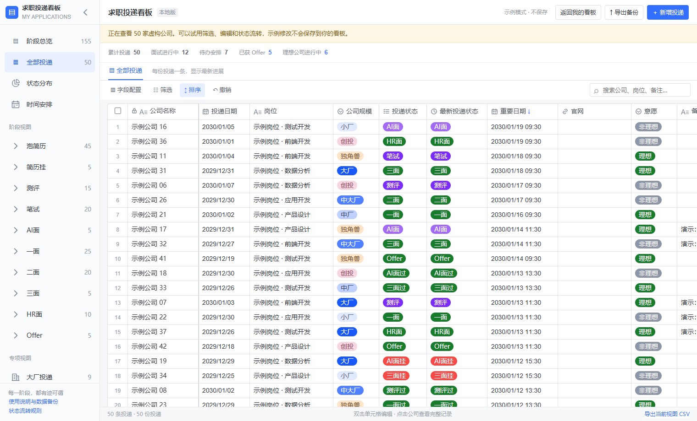
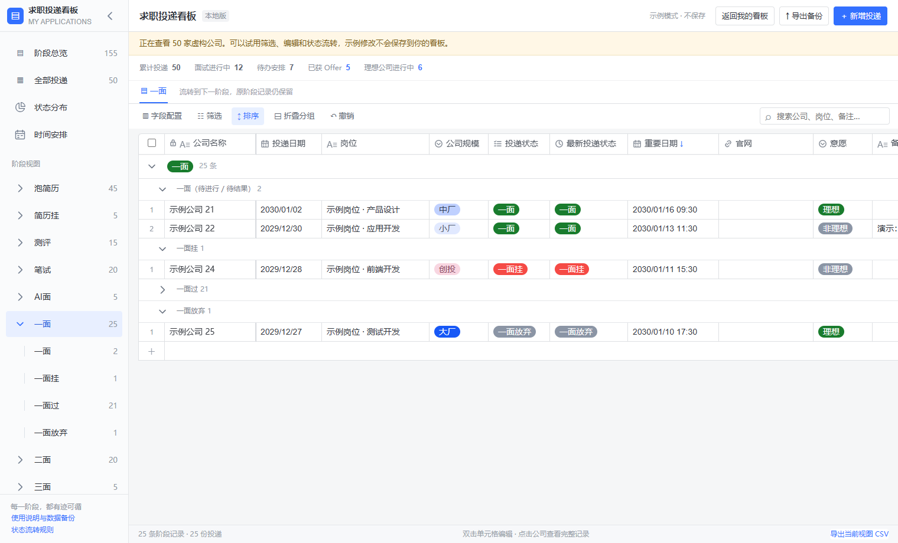
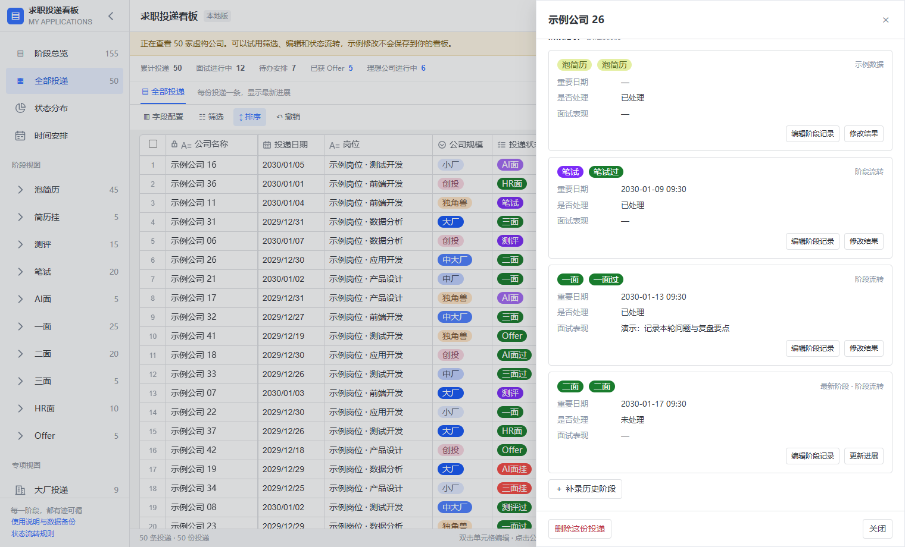
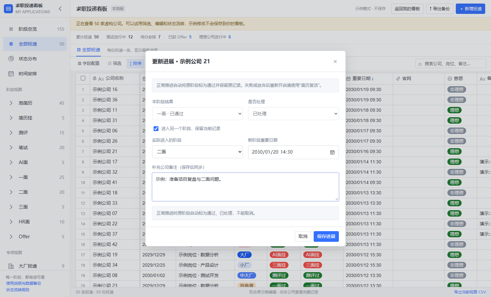
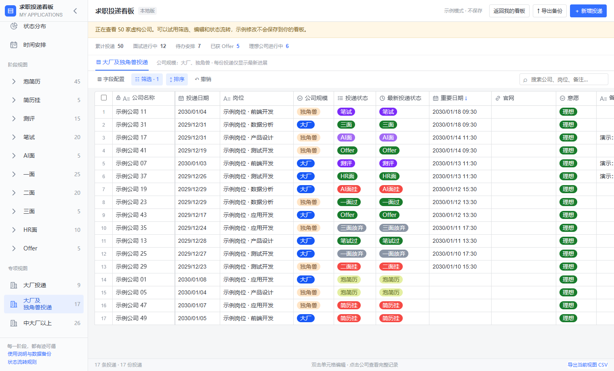
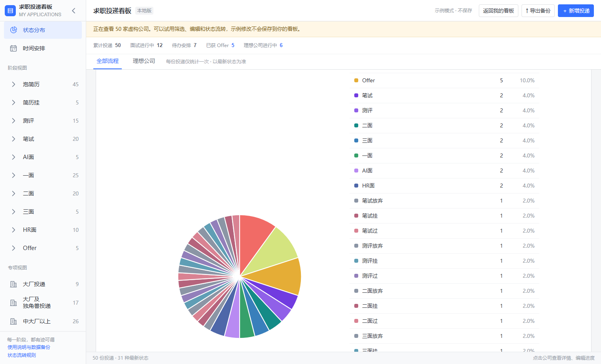
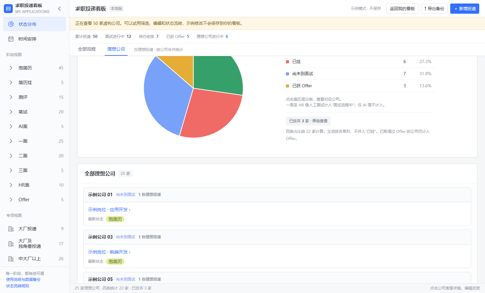
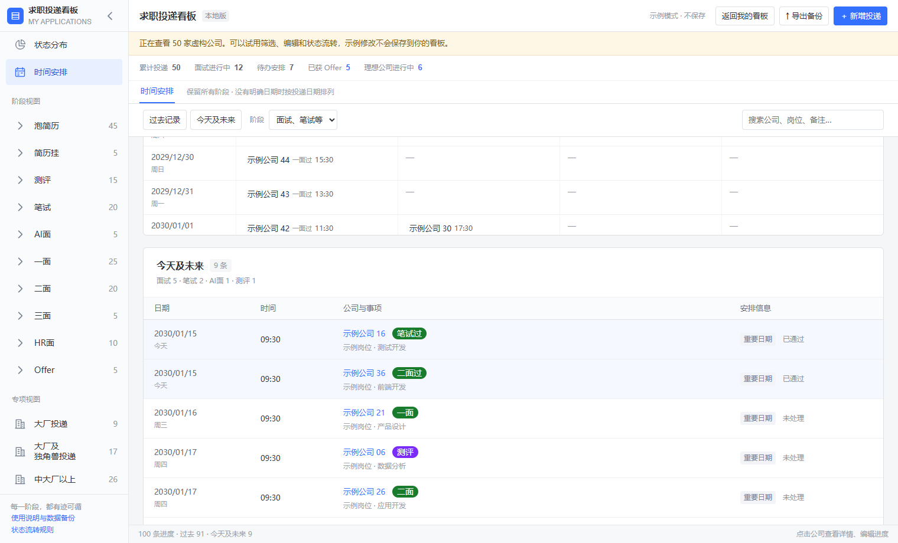
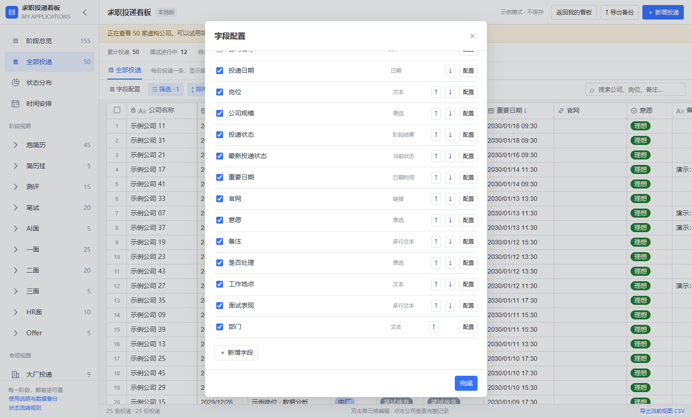
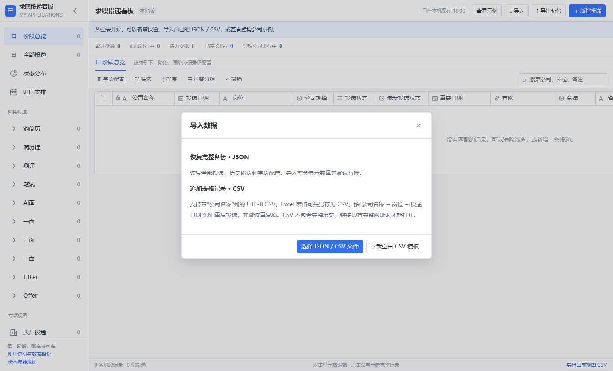

# 求职投递看板

一个可以离线使用的求职投递看板。跟踪投递、测评、笔试、面试和 Offer，保留每次阶段变化，支持筛选、状态分布和时间安排。

## 使用

1. 下载 [`index.html`](index.html) 的原始文件，或用 GitHub 的 **Code → Download ZIP** 下载后解压。
2. 双击打开 `index.html`。个人看板默认是空的；点击 **新增投递** 或 **导入** 即可开始。
3. 想先体验功能，点击 **查看示例**。示例包含 50 家编号虚构公司，10 个主要阶段各 5 家，覆盖待处理、已通过、未通过、主动放弃和 Offer 等状态。点 **返回我的看板** 可回到个人记录，示例编辑不会保存到个人看板。

无需安装依赖、注册账号或启动服务器。投递数据存储在当前浏览器，不会发送到 GitHub 或服务器；点击记录里的招聘链接会打开对应外部网页。浏览器的数据可能因换设备、换浏览器、移动文件或清除存储而无法读取，请用 **导出备份** 保存 JSON。这个仓库只有通用代码和程序生成的虚构示例，不要将自己的备份、导出表格或截图提交到公开仓库。

## 功能截图

以下截图均在独立测试环境中拍摄。所有公司、岗位和日期均为演示内容，导入界面使用空白看板。点击图片可查看原图。

**全部投递**：50 家虚构公司按重要日期排序，每家公司一行，查看最新状态、规模和意愿。

[](docs/screenshots/01-board.png)

### 管理投递与面试进度

| 阶段结果 | 公司详情 |
| --- | --- |
| [](docs/screenshots/02-stage-results.png) | [](docs/screenshots/03-company-detail.png) |
| 按待进行、未通过、已通过和主动放弃查看面试记录。 | 在一处查看公司信息、备注和已记录的面试轮次。 |

| 流转到下一阶段 | 专项视图与筛选 |
| --- | --- |
| [](docs/screenshots/04-stage-transition.png) | [](docs/screenshots/05-specialty-filter.png) |
| 选择下一阶段并填写时间、备注；历史阶段会保留。 | 在「大厂及独角兽」视图中按意愿筛出目标投递。 |

### 查看统计与时间安排

| 全部状态分布 | 理想公司进度 |
| --- | --- |
| [](docs/screenshots/06-status-distribution.png) | [](docs/screenshots/07-ideal-companies.png) |
| 每份投递按最新状态计一次，点击图例查看对应记录。 | 单独查看理想公司中尚未面试、面试中、已挂和已获 Offer 的分布。 |

**时间安排**：汇总已记录的测评、笔试和面试日期，可在过去记录与未来安排之间跳转。

[](docs/screenshots/08-schedule.png)

### 自定义字段与导入数据

| 字段配置 | 导入自己的数据 |
| --- | --- |
| [](docs/screenshots/09-field-settings.png) | [](docs/screenshots/10-import.png) |
| 控制列的显示、顺序和选项，也可以新增自定义字段。 | 下载空白 CSV 模板、追加自己的记录，或恢复完整 JSON 备份。 |

## 导入自己的记录

- **CSV**：点击 **导入 → 下载空白 CSV 模板**，填写后以 UTF-8 CSV 保存，再导入追加。`公司名称` 必填，其它列可留空。同公司、岗位和投递日期完全相同的行视为重复。Excel 文件可先另存为 UTF-8 CSV。
- **JSON**：用于恢复此看板导出的完整备份，包括历史阶段和字段配置。确认恢复后会替换当前看板。

一个最小的 CSV 示例：

```csv
公司名称,投递日期,岗位,投递状态,重要日期,是否处理
示例公司 A,2030-01-10,示例岗位,一面,2030-01-16 14:30,未处理
示例公司 B,2030-01-11,示例岗位,测评挂,,已处理
```

状态可以填写 `泡简历`、`测评`、`笔试`、`AI面`、`一面`、`二面`、`三面`、`HR面`、`Offer` 等。阶段结果使用 `一面过`、`一面挂`、`一面放弃` 等形式。CSV 是平面表格；要完整保存阶段历史，请导出 JSON。

## 从源码构建

`src/app.template.html` 包含页面结构和表格逻辑；`src/` 内其它模块实现状态流转、备注、统计和日程。`demo_data.py` 通过固定规则生成虚构记录，不读取任何数据文件。

```sh
python build.py
python build.py --check
```

构建仅用 Python 标准库。生成的 `index.html` 自包含，不加载远程脚本、字体或样式。可选的浏览器冒烟检查使用 Playwright：`npm install --no-save playwright`、`npx playwright install chromium` 后运行 `node tests/smoke.cjs`。

重新生成 README 截图可运行 `node tests/capture-readme.cjs`。脚本会打开独立的虚构示例和空白看板，并在 `docs/screenshots/` 保存截图。
